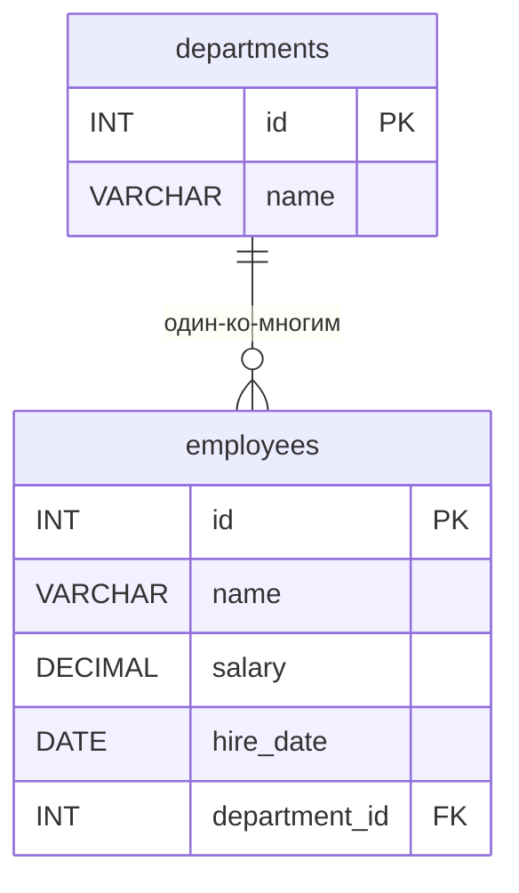

# ИТ.03 - 42 - Обобщённые табличные выражения (CTE) в MySQL

## Введение

В лекциях 39–40 мы разобрали оконные функции MySQL 8.0, и уже тогда столкнулись с ситуацией, когда результат оконного вычисления нужно использовать дальше: отфильтровать строки по номеру `ROW_NUMBER()`, удалить дубликаты, вычислить медиану или долю строк по `CUME_DIST()`. Оконную функцию нельзя вызывать в `WHERE`, поэтому мы каждый раз «оборачивали» запрос в конструкцию `WITH ... AS (...)`, после чего обращались к её результату как к обычной таблице. В практикуме 41 этот приём использовался уже активно — для топ-N, дедупликации и комбинированных запросов.

Эта лекция посвящена конструкции, о которой мы говорили вскользь: **обобщённым табличным выражениям** (Common Table Expressions, **CTE**). Мы разберём её системно: синтаксис, несколько CTE в одном запросе, многократное использование, рекурсивные CTE, сравнение с подзапросами и представлениями (лекция 22) и ограничения MySQL.

**В этой лекции**:
- что такое CTE и какие задачи они решают;
- базовый синтаксис `WITH ... AS (...)` в `SELECT`, `UPDATE` и `DELETE`;
- несколько CTE в одном запросе и ссылки одного CTE на другое;
- многократное использование одного CTE (самосоединение);
- рекурсивные CTE: `WITH RECURSIVE`, якорная и рекурсивная часть;
- типовые задачи: топ-N по группам, дедупликация, дерево категорий;
- сравнение CTE с подзапросами и представлениями;
- ограничения, глубина рекурсии и вопросы производительности.

Все примеры используют учебную базу данных из лекций 39–40:

::: tabs

@tab Структура БД



@tab Дамп

```sql
-- Создание таблицы departments
CREATE TABLE departments (
    id INT PRIMARY KEY AUTO_INCREMENT,
    name VARCHAR(100) NOT NULL
);

-- Создание таблицы employees
CREATE TABLE employees (
    id INT PRIMARY KEY AUTO_INCREMENT,
    name VARCHAR(100) NOT NULL,
    salary DECIMAL(10,2) DEFAULT 0.00,
    hire_date DATE,
    department_id INT,
    FOREIGN KEY (department_id) REFERENCES departments(id)
);

-- Вставка тестовых данных
INSERT INTO departments (name) VALUES
('Разработка'),
('Маркетинг'),
('Финансы');

INSERT INTO employees (name, salary, hire_date, department_id) VALUES
('Иван Петров',     85000.00, '2019-03-15', 1),
('Мария Сидорова',  92000.00, '2018-11-01', 1),
('Алексей Иванов',  78000.00, '2020-06-20', 2),
('Ольга Кузнецова', 95000.00, '2017-02-10', 3),
('Дмитрий Смирнов', 88000.00, '2021-09-05', 1),
('Елена Волкова',   76000.00, '2022-01-17', 2),
('Сергей Козлов',   92000.00, '2019-08-30', 3),
('Анна Морозова',   85000.00, '2023-04-12', 1),
('Павел Лебедев',   99000.00, '2016-05-23', 3),
('Наталья Орлова',  81000.00, '2021-12-01', 2);
```

@tab Данные

| id | name              | salary   | hire_date  | department_id |
|----|-------------------|----------|------------|---------------|
| 1  | Иван Петров       | 85000.00 | 2019-03-15 | 1             |
| 2  | Мария Сидорова    | 92000.00 | 2018-11-01 | 1             |
| 3  | Алексей Иванов    | 78000.00 | 2020-06-20 | 2             |
| 4  | Ольга Кузнецова   | 95000.00 | 2017-02-10 | 3             |
| 5  | Дмитрий Смирнов   | 88000.00 | 2021-09-05 | 1             |
| 6  | Елена Волкова     | 76000.00 | 2022-01-17 | 2             |
| 7  | Сергей Козлов     | 92000.00 | 2019-08-30 | 3             |
| 8  | Анна Морозова     | 85000.00 | 2023-04-12 | 1             |
| 9  | Павел Лебедев     | 99000.00 | 2016-05-23 | 3             |
| 10 | Наталья Орлова    | 81000.00 | 2021-12-01 | 2             |

:::

::: tip

Если вы выполняли практикум 41 и расширили базу до четырёх отделов и 16 сотрудников — примеры будут работать и там, но цифры в таблицах результатов окажутся другими. Для совпадения с этой лекцией используйте исходную базу из лекции 39.

:::

---

## Что такое CTE

**Обобщённое табличное выражение (CTE, Common Table Expression)** — это именованный временный результат запроса, который существует только в пределах одного SQL-выражения (одного `SELECT`, `UPDATE` или `DELETE`). По синтаксису CTE вводится ключевым словом `WITH`, а внутри основного запроса на него можно ссылаться по имени так же, как на обычную таблицу или представление.

Ключевая идея — **разбить сложный запрос на этапы и дать каждому этапу имя**:

- запрос становится читаемым: вместо вложенных «матрешек» из подзапросов видна последовательность шагов;
- промежуточный результат можно использовать **несколько раз** в одном запросе;
- появляется возможность **рекурсии** — CTE может ссылаться сам на себя;
- на результат CTE можно накладывать фильтры, которые недоступны внутри (например, по оконным функциям — см. лекции 40–41);
- отчёт проще сопровождать: каждый шаг проверяется отдельно.

::: note

Важное отличие от представления (`VIEW`, лекция 22): CTE **не хранится** в базе данных и невидим для других запросов и пользователей. Это «одноразовая» именованная выборка в рамках текущего выражения. Представление же создаётся командой `CREATE VIEW` и живёт в базе постоянно.

:::

## Базовый синтаксис

```sql
WITH имя_cte [ (список_столбцов) ] AS (
    SELECT ...
)
SELECT ...
FROM имя_cte ...;
```

- `WITH` обязательно стоит **перед** основным запросом (и перед `SELECT`, `UPDATE`, `DELETE`);
- внутри скобок после `AS` находится обычный запрос `SELECT` — «тело» CTE;
- основной запрос может обращаться к `имя_cte` в `FROM`, `JOIN`, подзапросах и т.д.;
- можно объявить несколько CTE через запятую: `WITH cte1 AS (...), cte2 AS (...)` — при этом каждый следующий CTE может ссылаться на предыдущие;
- необязательный список столбцов позволяет переименовать столбцы результата.

### Пример 1: Простое CTE

Выделим в CTE высокооплачиваемых сотрудников (зарплата от 90 000), а основной запрос отсортирует результат.

```sql
WITH high_salary AS (
    SELECT name, salary, department_id
    FROM employees
    WHERE salary >= 90000
)
SELECT name, salary, department_id
FROM high_salary
ORDER BY salary DESC;
```

Результат:

| name              | salary   | department_id |
|-------------------|----------|---------------|
| Павел Лебедев     | 99000.00 | 3             |
| Ольга Кузнецова   | 95000.00 | 3             |
| Мария Сидорова    | 92000.00 | 1             |
| Сергей Козлов     | 92000.00 | 3             |

С точки зрения результата этот запрос эквивалентен одному `SELECT ... FROM employees WHERE salary >= 90000`. Но теперь этап «отбор высокооплачиваемых» получил имя и его можно переиспользовать или продолжить строить запрос поверх.

::: info

«Классический» аналог — подзапрос во `FROM`:

```sql
SELECT name, salary, department_id
FROM (SELECT name, salary, department_id
      FROM employees
      WHERE salary >= 90000) AS high_salary
ORDER BY salary DESC;
```

Разница прежде всего в читаемости и в возможности многократного использования имени (пример 3).

:::

### Пример 2: Несколько CTE в одном запросе

Покажем связку из двух CTE: первое считает среднюю зарплату по компании, второе отбирает сотрудников, зарабатывающих выше этой средней.

```sql
WITH avg_salary AS (
    SELECT AVG(salary) AS avg_sal
    FROM employees
),
above_avg AS (
    SELECT name, salary
    FROM employees
    WHERE salary > (SELECT avg_sal FROM avg_salary)
)
SELECT name, salary
FROM above_avg
ORDER BY salary DESC;
```

Результат:

| name              | salary   |
|-------------------|----------|
| Павел Лебедев     | 99000.00 |
| Ольга Кузнецова   | 95000.00 |
| Мария Сидорова    | 92000.00 |
| Сергей Козлов     | 92000.00 |

Средняя зарплата по компании — 87 100.00, поэтому выше неё оказались четыре сотрудника. Обратите внимание: CTE указываются через запятую, а второе CTE (`above_avg`) ссылается на первое (`avg_salary`) — такая цепочка допустима и широко применяется.

### Пример 3: Многократное использование одного CTE

Главное преимущество CTE перед подзапросом — имя можно использовать **несколько раз** в одном выражении. Классический пример — самосоединение: найдём пары сотрудников с одинаковой зарплатой.

```sql
WITH salaries AS (
    SELECT id, name, salary
    FROM employees
)
SELECT a.name AS emp_1, b.name AS emp_2, a.salary
FROM salaries a
JOIN salaries b ON a.salary = b.salary AND a.id < b.id
ORDER BY a.salary DESC;
```

Результат:

| emp_1           | emp_2           | salary   |
|-----------------|-----------------|----------|
| Мария Сидорова  | Сергей Козлов   | 92000.00 |
| Иван Петров     | Анна Морозова   | 85000.00 |

Условие `a.id < b.id` исключает «зеркальные» пары (A–B и B–A) и пары сотрудника с самим собой. С подзапросом пришлось бы дважды дублировать один и тот же код — CTE избавляет от копирования.

### Пример 4: CTE и оконные функции — топ-N по отделам

Как мы знаем из лекций 40–41, оконную функцию нельзя использовать в `WHERE`. Стандартный обходной путь: вычислить номера строк внутри CTE, а фильтр по ним применить во внешнем запросе. Это ровно тот приём, что использовался в практикуме 41.

```sql
WITH ranked AS (
    SELECT
        name,
        salary,
        department_id,
        ROW_NUMBER() OVER (PARTITION BY department_id ORDER BY salary DESC) AS rn
    FROM employees
)
SELECT name, salary, department_id
FROM ranked
WHERE rn <= 2
ORDER BY department_id, salary DESC;
```

Результат:

| name              | salary   | department_id |
|-------------------|----------|---------------|
| Мария Сидорова    | 92000.00 | 1             |
| Иван Петров       | 85000.00 | 1             |
| Наталья Орлова    | 81000.00 | 2             |
| Алексей Иванов    | 78000.00 | 2             |
| Павел Лебедев     | 99000.00 | 3             |
| Ольга Кузнецова   | 95000.00 | 3             |

Внутри CTE строки пронумерованы в пределах каждого отдела, снаружи отобраны первые две. Заменив `ROW_NUMBER()` на `RANK()` или `DENSE_RANK()`, мы учтём и сотрудников с одинаковой зарплатой, претендующих на одно место (см. лекцию 40, пример 6).

### Пример 5: CTE в UPDATE и DELETE

CTE можно использовать не только в `SELECT`, но и в `UPDATE` и `DELETE` — это удобно для массовой обработки данных. Вернёмся к задаче дедупликации из лекции 40: после импорта в таблице могли появиться одинаковые записи. Пронумеруем строки внутри групп `(name, department_id)` и удалим все, кроме первой.

```sql
WITH numbered AS (
    SELECT
        id,
        ROW_NUMBER() OVER (PARTITION BY name, department_id ORDER BY id) AS rn
    FROM employees
)
DELETE e
FROM employees e
JOIN numbered n ON n.id = e.id
WHERE n.rn > 1;
```

В нашей базе дубликатов нет, поэтому запрос просто ничего не удалит. Но если перед импортом добавить две одинаковые записи «Дмитрий Смирнов» из отдела 1 — как в практикуме 41 — запрос корректно оставит только первую из группы.

::: tip

Аналогично работает `UPDATE`: внутри CTE можно вычислить нужные значения (например, ранги, суммы, границы групп), а затем изменить строки основной таблицы, соединив её с CTE.

:::

---

## Рекурсивные CTE

Рекурсия — возможность, которой нет ни у подзапросов, ни у представлений. **Рекурсивное CTE** ссылается само на себя: результат строится итерациями, пока не будет достигнуто условие остановки.

Синтаксис:

```sql
WITH RECURSIVE имя_cte AS (
    SELECT ...            -- якорная часть (anchor): начальный набор строк
    UNION ALL
    SELECT ...            -- рекурсивная часть: ссылается на имя_cte
)
SELECT ... FROM имя_cte ...;
```

Якорная часть выполняется один раз и даёт первую порцию строк. Затем рекурсивная часть выполняется снова и снова: каждая следующая итерация использует строки, полученные на предыдущей, и добавляет новые, пока очередная итерация не вернёт пустой результат.

::: warning

Между якорной и рекурсивной частью обязательно должен быть `UNION ALL` (или `UNION [DISTINCT]`). Без `WITH RECURSIVE` обращаться к CTE внутри его же определения нельзя — MySQL вернёт ошибку.

:::

### Пример 6: Генерация последовательности чисел

Простейшая рекурсия — ряд чисел от 1 до 10. Якорная часть даёт единицу, рекурсивная добавляет по единице на каждой итерации.

```sql
WITH RECURSIVE seq AS (
    SELECT 1 AS n
    UNION ALL
    SELECT n + 1 FROM seq WHERE n < 10
)
SELECT n
FROM seq;
```

Результат:

| n  |
|----|
| 1  |
| 2  |
| 3  |
| 4  |
| 5  |
| 6  |
| 7  |
| 8  |
| 9  |
| 10 |

Итерации: якорь даёт `n = 1`; первая рекурсивная итерация — `2`; затем `3` и так далее, пока `n < 10` истинно. Когда рекурсивная часть перестаёт добавлять строки (при `n = 10` условие `n < 10` ложно), построение завершается.

Такой приём полезен, например, для заполнения «календарной» таблицы или отсутствующих дат в отчёте.

::: info

Условие остановки может быть любым: `WHERE n < 10`, `WHERE n <= 50`, сравнение с датой и т.д. Важно, чтобы оно рано или поздно стало ложным — иначе рекурсия упрётся в ограничение глубины (см. ниже).

:::

### Пример 7: Иерархия — дерево категорий интернет-магазина

Самая частая область применения рекурсивных CTE — работа с иерархиями: каталоги, организационные структуры, вложенные комментарии. Такие данные хранятся в одной таблице, где каждая строка ссылается на родителя через внешний ключ.

Создадим таблицу категорий, где `parent_id` указывает на родительскую категорию (у корневых категорий он равен `NULL`):

```sql
CREATE TABLE categories (
    id INT PRIMARY KEY AUTO_INCREMENT,
    name VARCHAR(100) NOT NULL,
    parent_id INT NULL,
    FOREIGN KEY (parent_id) REFERENCES categories(id)
);

INSERT INTO categories (name, parent_id) VALUES
('Электроника',    NULL),
('Бытовая техника', NULL),
('Смартфоны',      1),
('Ноутбуки',       1),
('Телевизоры',     2),
('Холодильники',   2),
('iPhone',         3),
('Android',        3);
```

Построим всё дерево с уровнем вложенности:

```sql
WITH RECURSIVE cat_tree AS (
    -- Якорная часть: корневые категории
    SELECT id, name, parent_id, 1 AS lvl
    FROM categories
    WHERE parent_id IS NULL

    UNION ALL

    -- Рекурсивная часть: потомки уже найденных категорий
    SELECT c.id, c.name, c.parent_id, t.lvl + 1
    FROM categories c
    JOIN cat_tree t ON c.parent_id = t.id
)
SELECT lvl, id, name
FROM cat_tree
ORDER BY lvl, id;
```

Результат:

| lvl | id | name             |
|-----|----|------------------|
| 1   | 1  | Электроника      |
| 1   | 2  | Бытовая техника  |
| 2   | 3  | Смартфоны        |
| 2   | 4  | Ноутбуки         |
| 2   | 5  | Телевизоры       |
| 2   | 6  | Холодильники     |
| 3   | 7  | iPhone           |
| 3   | 8  | Android          |

Как это работает:

1. **Якорь** выбирает корни: «Электроника» (`lvl = 1`) и «Бытовая техника» (`lvl = 1`).
2. **Итерация 1** находит их прямых потомков: «Смартфоны», «Ноутбуки» (`lvl = 2`), «Телевизоры», «Холодильники» (`lvl = 2`).
3. **Итерация 2** находит потомков «Смартфоны»: «iPhone», «Android» (`lvl = 3`).
4. Итерация 3 добавляет ноль строк — рекурсия завершается.

Обратите внимание: рекурсивная часть — это `JOIN` между таблицей категорий и уже накопленным CTE. На каждой итерации «вырастает» следующий уровень дерева.

::: tip

Рекурсивные CTE легко переделываются под конкретные вопросы: «все подкатегории товара», «весь путь от корня до листа», «сколько уровней у самого глубокого узла». Достаточно изменить якорную часть (стартовая точка) и выражение в рекурсивной части.

:::

### Глубина рекурсии и ограничение итераций

В MySQL действует системная переменная `cte_max_recursion_depth`, которая ограничивает число итераций рекурсивного CTE. По умолчанию это **1000**. При превышении сервер прерывает запрос:

```
ERROR 3636 (HY000): Recursive query aborted after 1001 iterations.
Try increasing the value of the 'cte_max_recursion_depth' system variable.
```

Лимит повышается на сессию:

```sql
SET SESSION cte_max_recursion_depth = 1000000;
```

После этого рекурсия, способная превысить стандартные 1000 итераций (например, до 2000), выполнится успешно:

```sql
SET SESSION cte_max_recursion_depth = 2000;

WITH RECURSIVE seq AS (
    SELECT 1 AS n
    UNION ALL
    SELECT n + 1 FROM seq WHERE n < 2000
)
SELECT n FROM seq;
```

::: warning

Всегда следите за условием остановки. Если оно никогда не станет ложным (например, `WHERE n > 0` вместо `WHERE n < 10`), запрос будет выполняться до исчерпания лимита глубины и упадёт с ошибкой 3636.

:::

---

## CTE, подзапросы и представления: сравнение

Теперь, когда мы знаем и CTE, и `VIEW` (лекция 22), и подзапросы, сведём их в единую таблицу:

| Характеристика                   | CTE                                      | Подзапрос                                | Представление (`VIEW`)                 |
|----------------------------------|------------------------------------------|------------------------------------------|----------------------------------------|
| Где живёт                        | в пределах одного запроса                | внутри выражения                          | постоянно в базе данных                 |
| Имя и многократное использование | да, можно ссылаться несколько раз        | нет, код приходится дублировать          | да, многократно и из разных запросов    |
| Рекурсия                         | да (`WITH RECURSIVE`)                    | нет                                      | нет                                    |
| Хранится в схеме БД              | нет                                      | нет                                      | да (`CREATE VIEW`)                     |
| Права доступа                     | не выделяются                            | не выделяются                            | можно выдавать доступ только на `VIEW` |
| Читаемость сложных запросов      | высокая: шаги поименованы                | низкая: вложенность растёт               | высокая: имя скрывает запрос           |
| Обновление данных                | `UPDATE`/`DELETE` с `JOIN` по CTE        | обычно только чтение                     | обновляемые представления (см. лекцию 22) |
| Когда применять                  | многошаговый/рекурсивный запрос в отчёте | простое скалярное значение, `EXISTS`     | повторяющийся отчёт, инкапсуляция доступа |

Практическое правило:

- **подзапрос** — для простых случаев: сравнение со скаляром, проверка существования, фильтр по подмножеству;
- **CTE** — когда запрос многошаговый, требует повторного использования промежуточного результата, фильтрации по оконным функциям или рекурсии;
- **VIEW** — когда один и тот же результат нужен в разных сессиях и приложениях, а доступ к нему нужно контролировать.

---

## Правила и ограничения CTE в MySQL

Основные особенности поведения CTE в MySQL 8:

1. **Версия.** CTE доступны начиная с **MySQL 8.0** — как и оконные функции. В более старых версиях и в SQLite (в учебном курсе) запросы строятся через подзапросы.

2. **Область видимости.** Имя CTE действует только в пределах текущего выражения. Два разных запроса не видят CTE друг друга — это не представление.

3. **Уникальность имён.** Имена CTE в одном выражении должны быть уникальны. Повторное объявление имени — ошибка.

4. **Порядок объявления.** CTE объявляются слева направо: `cte2` может ссылаться на `cte1`, но не наоборот. Ссылка на ещё не объявленное имя — ошибка.

5. **Рекурсия только явная.** Обычный CTE не может ссылаться сам на себя. Для этого нужно ключевое слово `RECURSIVE` и `UNION ALL`/`UNION` между якорной и рекурсивной частями.

6. **Ограничения рекурсивной части.** В рекурсивной части (после `UNION ALL`) нельзя использовать агрегатные функции, оконные функции, `GROUP BY`, `ORDER BY`, `LIMIT`, `DISTINCT`. Если такие операции нужны — выполните их вне рекурсивного CTE.

7. **Глубина рекурсии.** Число итераций ограничено переменной `cte_max_recursion_depth` (по умолчанию 1000), при превышении — ошибка 3636.

8. **Вложенность `WITH`.** До версии **MySQL 8.0.19** конструкция `WITH` не могла находиться внутри подзапроса (вложенное CTE). В современных версиях это допустимо, но для читаемости лучше избегать глубокой вложенности.

9. **Материализация.** MySQL может как материализовать результат CTE во временную таблицу, так и «встроить» его в основной запрос как подзапрос. Стратегию выбирает оптимизатор (в `EXPLAIN` материализация отображается как `Materialized` в колонке `select_type`).

::: info

Классическая ошибка новичка — попытка использовать CTE в следующем запросе сессии:

```sql
WITH t AS (SELECT 1 AS x)
SELECT x FROM t;      -- OK, один запрос

SELECT x FROM t;      -- ОШИБКА: таблица t не существует!
```

CTE «живёт» ровно одно выражение. Если результат нужен постоянно — создавайте представление.

:::

---

## Порядок выполнения запроса с CTE

Логический порядок обработки запроса (не путать с физическим планом выполнения!) с учётом CTE выглядит так:

| Шаг | Секция                | Что происходит                                                       |
|-----|-----------------------|----------------------------------------------------------------------|
| 1   | `WITH` (CTE)          | Вычисляются обобщённые табличные выражения (или встраиваются)        |
| 2   | `FROM` / `JOIN`       | Формируется исходный набор строк, в том числе из CTE                 |
| 3   | `WHERE`               | Отсеиваются строки, не удовлетворяющие условиям                      |
| 4   | `GROUP BY`            | Строки группируются (если задана группировка)                        |
| 5   | `HAVING`              | Отсеиваются группы                                                    |
| 6   | Оконные функции       | Вычисляются значения `OVER(...)` над строками/группами этого этапа    |
| 7   | `SELECT`              | Формируются выходные столбцы                                         |
| 8   | `DISTINCT`            | Удаляются дублирующиеся строки результата                            |
| 9   | `ORDER BY`            | Сортируется итоговый результат                                        |
| 10  | `LIMIT` / `OFFSET`    | Ограничивается количество возвращаемых строк                         |

Из таблицы следует важный вывод: к результатам CTE основной запрос обращается на этапе `FROM`/`JOIN`, поэтому в `WHERE` и `GROUP BY` можно использовать «столбцы» CTE наравне со столбцами обычных таблиц — именно это делает возможным фильтрацию по оконным функциям (пример 4).

---

## Производительность

Несколько практических рекомендаций по работе с CTE на больших таблицах:

1. **Сужайте данные внутри CTE.** Условия отбора лучше помещать в тело CTE (`WHERE ...` внутри скобок), а не применять фильтр потом. Чем меньше строк дойдёт до внешнего запроса, тем быстрее соединения и сортировки.

2. **Помните про материализацию.** Если CTE используется несколько раз, MySQL материализует его во временную таблицу (в `EXPLAIN` — `Materialized`). Как правило, у материализованной таблицы нет собственных индексов (оптимизатор может построить их лишь в отдельных случаях), поэтому фильтры по ней могут быть дорогими: фильтруйте CTE как можно раньше.

3. **Индексы исходных таблиц.** Для `JOIN` CTE с большой таблицей полезны индексы на ключах соединения — материализованный результат читается по строкам, и быстрый поиск по основной таблице критичен.

4. **Предпочитайте `UNION ALL`.** В рекурсивных CTE `UNION ALL` не удаляет дубликаты, что быстрее, чем `UNION` (который добавляет сортировку и дедупликацию). Используйте `UNION` только когда дубликаты действительно нужно убрать.

5. **Не злоупотребляйте рекурсией.** Каждая итерация — это повторное выполнение рекурсивной части. Постройте условие остановки по индексируемому столбцу и проверяйте план через `EXPLAIN`.

6. **CTE вместо подзапросов для переиспользования.** Если промежуточный результат фигурирует в запросе дважды, CTE избавляет от двойного вычисления одного и того же подзапроса (хотя окончательное решение всё равно принимает оптимизатор).

::: tip

При отладке большого запроса с CTE удобно «вытащить» тело CTE в отдельный `SELECT` и выполнить его самостоятельно — проверить, что промежуточный шаг даёт ожидаемый результат, а затем вернуть его обратно в `WITH`.

:::

---

## Задания для самостоятельной работы

### Задание 1

::: tabs

@tab Условие

С помощью CTE выведите сотрудников, чья зарплата **выше средней по их отделу**. В результате должны быть столбцы `name`, `salary`, `department_id`, отсортированные по отделу и убыванию зарплаты.

Подсказка: первым CTE посчитайте `AVG(salary)` с группировкой по `department_id`, затем соедините его с таблицей `employees` и отфильтруйте строки.

@tab Решение

```sql
WITH dept_avg AS (
    SELECT department_id, AVG(salary) AS avg_sal
    FROM employees
    GROUP BY department_id
)
SELECT e.name, e.salary, e.department_id
FROM employees e
JOIN dept_avg d ON d.department_id = e.department_id
WHERE e.salary > d.avg_sal
ORDER BY e.department_id, e.salary DESC;
```

Результат:

| name              | salary   | department_id |
|-------------------|----------|---------------|
| Мария Сидорова    | 92000.00 | 1             |
| Дмитрий Смирнов   | 88000.00 | 1             |
| Наталья Орлова    | 81000.00 | 2             |
| Павел Лебедев     | 99000.00 | 3             |

Проверка: средняя по отделу 1 — 87 500.00, по отделу 2 — 78 333.33, по отделу 3 — 95 333.33. Ольга Кузнецова (95 000.00) не попадает в результат — её зарплата чуть ниже средней по финансовому отделу.

:::

### Задание 2

::: tabs

@tab Условие

Рекурсивным CTE постройте **числа Фибоначчи** от 0 до 34: столбцы `n` (номер числа) и `fib` (само число). Первые два числа — 0 и 1, каждое следующее — сумма двух предыдущих.

Подсказка: держите в рекурсивной части два последних числа: `fib_prev` и `fib_curr`. Якорь — `SELECT 1, 0, 1` (номер и два первых числа).

@tab Решение

```sql
WITH RECURSIVE fib AS (
    SELECT 1 AS n, 0 AS fib_prev, 1 AS fib_curr
    UNION ALL
    SELECT n + 1, fib_curr, fib_prev + fib_curr
    FROM fib
    WHERE n < 10
)
SELECT n, fib_prev AS fib
FROM fib;
```

Результат:

| n  | fib |
|----|-----|
| 1  | 0   |
| 2  | 1   |
| 3  | 1   |
| 4  | 2   |
| 5  | 3   |
| 6  | 5   |
| 7  | 8   |
| 8  | 13  |
| 9  | 21  |
| 10 | 34  |

Каждая итерация «сдвигает» пару чисел: новое `fib_prev` — старое `fib_curr`, новое `fib_curr` — их сумма. Классический пример переиспользования двух значений из предыдущей строки рекурсии.

:::

### Задание 3

::: tabs

@tab Условие

На таблице `categories` из примера 7 выведите **все категории, которые относятся к «Электроника»**, включая саму «Электронику»: столбцы `id`, `name`. Якорь — категория с именем `'Электроника'`, рекурсивная часть — её потомки.

@tab Решение

```sql
WITH RECURSIVE electronics AS (
    SELECT id, name, parent_id
    FROM categories
    WHERE name = 'Электроника'

    UNION ALL

    SELECT c.id, c.name, c.parent_id
    FROM categories c
    JOIN electronics e ON c.parent_id = e.id
)
SELECT id, name
FROM electronics;
```

Результат (порядок строк может отличаться):

| id | name        |
|----|-------------|
| 1  | Электроника |
| 3  | Смартфоны   |
| 4  | Ноутбуки    |
| 7  | iPhone      |
| 8  | Android     |

Изменив строку-якорь (`WHERE name = 'Бытовая техника'`), получите поддерево бытовой техники: «Телевизоры» и «Холодильники». Так рекурсивные CTE отвечают на вопрос «что лежит внутри узла» для любого уровня вложенности.

:::

---

## Заключение

В этой лекции мы разобрали обобщённые табличные выражения MySQL 8.0: базовый синтаксис `WITH ... AS (...)`, несколько CTE в одном запросе с цепочкой ссылок, многократное использование имени (самосоединение), применение CTE в `UPDATE` и `DELETE`, рекурсивные CTE с якорной и рекурсивной частью, а также ограничения глубины рекурсии.

CTE — незаменимый инструмент для многошаговых запросов: они делают код читаемым, позволяют переиспользовать промежуточные результаты, «разрешают» фильтрацию по оконным функциям и открывают рекурсию для работы с иерархиями. Вместе с оконными функциями (лекции 39–41) и представлениями (лекция 22) они покрывают большинство задач аналитических отчётов в MySQL.

## Полезные ссылки

- [MySQL 8.4 Reference Manual: WITH (Common Table Expressions)](https://dev.mysql.com/doc/refman/8.4/en/with.html)
- [MySQL 8.4 Reference Manual: Recursive Common Table Expressions](https://dev.mysql.com/doc/refman/8.4/en/with.html#common-table-expressions-recursive)
- [MySQL 8.4 Reference Manual: Optimizer Hints and CTE Materialization](https://dev.mysql.com/doc/refman/8.4/en/optimizer-hints.html)
