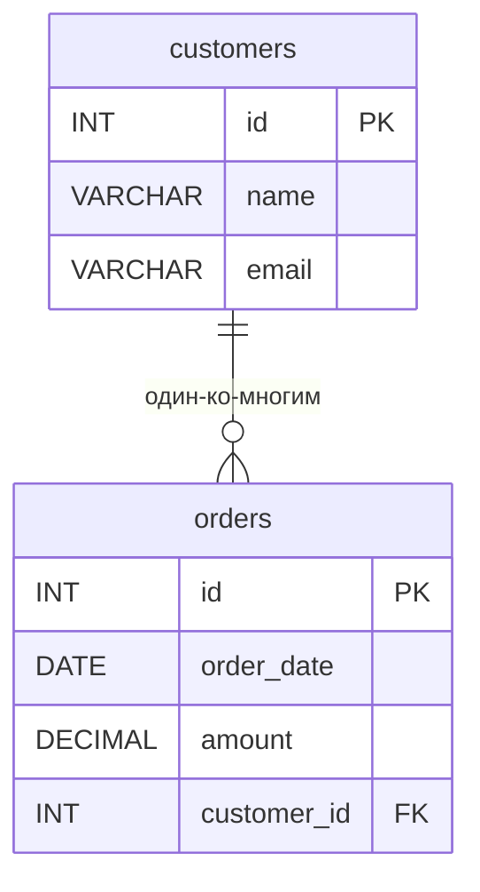

# ИТ.03 - 43 - Защита баз данных: пользователи, права и роли в MySQL

## Введение

До сих пор мы работали с MySQL под одной учётной записью — как правило, `root`, у которого есть неограниченные права на всё. Для учебных задач это удобно, но в реальных системах так делать нельзя: приложение, аналитик и администратор должны иметь **разные** права. Если веб-приложение подключается к базе под `root`, то одна SQL-инъекция (или просто ошибка в коде) приводит к удалению всех данных. Защита базы данных начинается именно с этого: **кто подключается** (пользователи), **что ему разрешено** (привилегии) и **как удобно выдавать наборы прав** (роли).

Эта лекция посвящена механизму управления доступом MySQL 8.0+ (примеры проверены на MySQL 8.4). Мы разберём учётные записи, привилегии всех уровней и роли, а в конце — практический сценарий настройки доступа для небольшого приложения.

**В этой лекции**:
- как MySQL решает две задачи безопасности: аутентификацию и авторизацию;
- учётные записи `user@host`, создание, изменение и удаление пользователей;
- пароли и политики паролей;
- уровни привилегий: глобальные, базы данных, таблицы, столбцы, подпрограммы;
- команды `GRANT`, `REVOKE`, `SHOW GRANTS` и системная база `mysql`;
- роли: `CREATE ROLE`, назначение пользователям, активация и роли по умолчанию;
- принцип минимальных привилегий и типовые сценарии.

Все примеры используют небольшую учебную базу данных интернет-магазина:

::: tabs

@tab Структура БД



@tab Дамп

```sql
-- Создание схемы и таблиц
CREATE DATABASE IF NOT EXISTS shop;

CREATE TABLE shop.customers (
    id INT PRIMARY KEY AUTO_INCREMENT,
    name VARCHAR(100) NOT NULL,
    email VARCHAR(100) NOT NULL UNIQUE
);

CREATE TABLE shop.orders (
    id INT PRIMARY KEY AUTO_INCREMENT,
    order_date DATE NOT NULL,
    amount DECIMAL(10,2) NOT NULL,
    customer_id INT,
    FOREIGN KEY (customer_id) REFERENCES shop.customers(id)
);

-- Вставка тестовых данных
INSERT INTO shop.customers (name, email) VALUES
('Иван Петров',     'ivan@example.com'),
('Мария Сидорова',  'maria@example.com'),
('Алексей Иванов',  'alexey@example.com');

INSERT INTO shop.orders (order_date, amount, customer_id) VALUES
('2024-01-15', 5000.00,  1),
('2024-02-03', 12000.50, 2),
('2024-02-20', 3400.00,  1),
('2024-03-08', 8700.00,  3);
```

:::

::: note

Все команды из этой лекции, если не оговорено иное, выполняются администратором — например, под `root`. Команды управления пользователями (`CREATE USER`, `GRANT` и т.д.) сами требуют привилегий, поэтому логично, что обычные пользователи их выполнять не могут.

:::

---

## Аутентификация и авторизация

MySQL решает две отдельные задачи безопасности:

1. **Аутентификация** — проверка того, *кто* подключается: имя пользователя, имя хоста, с которого идёт подключение, и пароль (или другой способ проверки).
2. **Авторизация** — проверка того, *что* этому пользователю разрешено: какие базы, таблицы и операции.

Проверка прав происходит в момент подключения и при каждом выполнении запроса. Поэтому даже если пользователю «выключили» право посреди сессии — оно применится к его следующим запросам.

## Учётные записи пользователей

### Имя пользователя и хост

Учётная запись в MySQL — это не просто имя, а пара **`'user'@'host'`**:

```sql
'user'@'localhost'       -- подключения только с самого сервера
'user'@'192.168.1.10'    -- только с конкретного адреса
'user'@'192.168.1.%'     -- с любого адреса подсети 192.168.1.x
'user'@'%'               -- с любого хоста (частая ошибка — слишком широко)
```

Это значит, что `anna@localhost` и `anna@%` — **две разные** учётные записи, у которых могут быть разные пароли и разные права. Часть `host` защищает от подключения «извне»: даже зная пароль, злоумышленник не сможет войти с чужой машины, если учётная запись ограничена `localhost`.

::: warning

Часть `host` — это адрес **клиента**, а не сервера. Учётная запись `'app'@'%'` разрешает подключение к серверу MySQL откуда угодно, и если MySQL доступен из интернета, такой пользователь — прямая цель для перебора паролей. По возможности ограничивайте хосты подсетью или конкретными адресами.

:::

### Создание пользователя

```sql
CREATE USER 'analyst'@'localhost' IDENTIFIED BY 'Str0ng!Pass';
```

- без указания хоста MySQL подставит `'%'`;
- пароль проверяется на сложность, если включён компонент `validate_password` (в MySQL 8 по умолчанию установлен);
- можно сразу задать срок действия пароля и лимит неудачных попыток:

```sql
CREATE USER 'report_bot'@'192.168.1.%' IDENTIFIED BY 'B0t!Pass9'
    PASSWORD EXPIRE INTERVAL 90 DAY
    FAILED_LOGIN_ATTEMPTS 5 PASSWORD_LOCK_TIME 2;
```

После пяти неверных паролей подряд (`FAILED_LOGIN_ATTEMPTS`) учётная запись блокируется на 2 дня (`PASSWORD_LOCK_TIME`).

### Изменение пользователя

```sql
-- Смена пароля
ALTER USER 'analyst'@'localhost' IDENTIFIED BY 'N3w!Pass7';

-- Требовать смену пароля при следующем входе
ALTER USER 'analyst'@'localhost' PASSWORD EXPIRE;

-- Временно заблокировать учётную запись
ALTER USER 'analyst'@'localhost' ACCOUNT LOCK;

-- Разблокировать
ALTER USER 'analyst'@'localhost' ACCOUNT UNLOCK;

-- Переименовать (вместе с хостом)
RENAME USER 'analyst'@'localhost' TO 'analyst'@'10.0.0.%';
```

### Удаление пользователя

```sql
DROP USER 'analyst'@'localhost';
```

`DROP USER` автоматически отзывает все привилегии и роли, назначенные пользователю, — отдельно ничего чистить не нужно.

### Просмотр пользователей

Список учётных записей хранится в системной базе `mysql`, таблица `mysql.user`:

```sql
SELECT user, host, account_locked
FROM mysql.user
ORDER BY user;
```

| user               | host           | account_locked |
|--------------------|----------------|----------------|
| analyst            | localhost      | N              |
| mysql.infoschema   | localhost      | Y              |
| mysql.session      | localhost      | Y              |
| mysql.sys          | localhost      | Y              |
| root               | localhost      | N              |

Записи `mysql.infoschema`, `mysql.session`, `mysql.sys` — служебные, их нельзя удалять. Таблица `mysql.user` — центральное место хранения прав, к нему вернёмся ниже.

## Привилегии

### Уровни привилегий

Привилегия — это право выполнить определённую операцию. В MySQL привилегии выдаются на **разных уровнях**, от самого широкого к самому узкому:

| Уровень         | Синтаксис в `GRANT`      | Пример                                      |
|-----------------|--------------------------|---------------------------------------------|
| Глобальный      | `ON *.*`                 | все базы на сервере                         |
| Базы данных     | `ON shop.*`              | все объекты базы `shop`                     |
| Таблицы         | `ON shop.orders`         | конкретная таблица                          |
| Столбцов        | `SELECT (col1, col2)`    | конкретные столбцы таблицы                  |
| Подпрограмм     | `ON FUNCTION shop.calc`  | хранимая процедура или функция (лекции 29–32)|

Более узкая привилегия **переопределяет** более широкую: если пользователю запрещён `DELETE` на всю базу, но разрешён на одной таблице — на этой таблице он сможет удалять строки.

### Основные привилегии

| Привилегия        | Что разрешает                                              |
|-------------------|------------------------------------------------------------|
| `SELECT`          | читать данные (`SELECT`)                                    |
| `INSERT`          | добавлять строки                                            |
| `UPDATE`          | изменять строки                                             |
| `DELETE`          | удалять строки                                              |
| `CREATE`          | создавать базы и таблицы                                    |
| `DROP`            | удалять базы и таблицы                                      |
| `ALTER`           | менять структуру таблиц                                     |
| `INDEX`           | создавать и удалять индексы                                 |
| `REFERENCES`      | создавать внешние ключи                                     |
| `CREATE VIEW`     | создавать представления (лекция 22)                         |
| `SHOW VIEW`       | смотреть определение представлений                          |
| `EXECUTE`         | вызывать хранимые процедуры и функции                       |
| `CREATE USER`     | управлять учётными записями                                 |
| `GRANT OPTION`    | передавать свои привилегии другим пользователям             |
| `ALL PRIVILEGES`  | все привилегии данного уровня (кроме `GRANT OPTION`)        |

### Выдача привилегий: GRANT

```sql
-- Читать и писать в базе shop, но не менять её структуру
GRANT SELECT, INSERT, UPDATE, DELETE ON shop.* TO 'app_user'@'localhost';

-- Только чтение одной таблицы
GRANT SELECT ON shop.customers TO 'auditor'@'localhost';

-- Чтение только отдельных столбцов (сумм и дат, но не клиентов)
GRANT SELECT (order_date, amount) ON shop.orders TO 'analyst'@'localhost';

-- Полный доступ к одной базе с правом передавать его дальше
GRANT ALL PRIVILEGES ON shop.* TO 'shop_admin'@'localhost' WITH GRANT OPTION;
```

### Просмотр прав: SHOW GRANTS

```sql
SHOW GRANTS FOR 'app_user'@'localhost';
```

```text
GRANT USAGE ON *.* TO `app_user`@`localhost`
GRANT SELECT, INSERT, UPDATE, DELETE ON `shop`.* TO `app_user`@`localhost`
```

`USAGE` означает «нет глобальных привилегий» — пользователь может подключаться, но глобально ничего не может.

Текущие права своей сессии можно посмотреть без указания пользователя:

```sql
SHOW GRANTS;          -- эквивалент SHOW GRANTS FOR CURRENT_USER;
SELECT CURRENT_USER();  -- под какой учётной записью вы работаете
```

### Отзыв привилегий: REVOKE

```sql
-- Забрать право удалять строки из базы shop
REVOKE DELETE ON shop.* FROM 'app_user'@'localhost';

-- Забрать всё, что выдано на уровне базы
REVOKE ALL PRIVILEGES ON shop.* FROM 'analyst'@'localhost';

-- Забрать право передавать привилегии
REVOKE GRANT OPTION ON shop.* FROM 'shop_admin'@'localhost';
```

::: note

В старых версиях MySQL после `GRANT`/`REVOKE` на уровне таблиц и столбцов советовали выполнять `FLUSH PRIVILEGES`. С MySQL 5.7+ это **не нужно**: изменения привилегий применяются автоматически. `FLUSH PRIVILEGES` нужен только в одном случае — когда вы изменили таблицы `mysql.user`, `mysql.db` и т.п. напрямую через `INSERT`/`UPDATE`, чего делать не рекомендуется.

:::

### Где хранятся привилегии

Вся информация о доступах — это обычные таблицы системной базы `mysql`:

| Таблица         | Содержимое                                                    |
|-----------------|---------------------------------------------------------------|
| `mysql.user`    | учётные записи и глобальные привилегии                        |
| `mysql.db`      | привилегии уровня баз данных                                  |
| `mysql.tables_priv` | привилегии уровня таблиц                                  |
| `mysql.columns_priv` | привилегии уровня столбцов                               |
| `mysql.procs_priv` | привилегии на процедуры и функции                          |
| `mysql.global_grants` | динамические привилегии (например, `BACKUP_ADMIN`)      |

Для удобного чтения используйте представления из `information_schema` или `sys`:

```sql
-- Права пользователя по уровням в человекочитаемом виде
SELECT * FROM information_schema.user_privileges
WHERE grantee LIKE "'app_user'%";
```

### Пример: столбцовые права на практике

Классический сценарий — сотрудник кадровой службы должен видеть имена, но не зарплаты (или наоборот). Проверим на учебной базе: дадим `analyst` право читать только сумму и дату заказа, но не клиента.

```sql
GRANT SELECT (order_date, amount) ON shop.orders TO 'analyst'@'localhost';
```

Теперь под пользователем `analyst`:

```sql
SELECT order_date, amount FROM shop.orders LIMIT 2;
```

| order_date | amount   |
|------------|----------|
| 2024-01-15 | 5000.00  |
| 2024-02-03 | 12000.50 |

```sql
SELECT customer_id FROM shop.orders;
```

```text
ERROR 1143 (42000): SELECT command denied to user 'analyst'@'localhost'
for column 'customer_id' in table 'orders'
```

Привилегия на столбцы работает как «белый список»: все столбцы, не перечисленные в `GRANT`, недоступны.

## Роли

Роль — это **именованный набор привилегий**. Вместо того чтобы выдавать десятки прав каждому пользователю по отдельности, права собирают в роли, а пользователям выдают роли. Изменить права целой группы людей можно одной командой — изменив роль.

### Создание роли и наполнение её правами

```sql
-- Роль «приложение магазина»: читать и писать данные
CREATE ROLE 'app_writer';
GRANT SELECT, INSERT, UPDATE, DELETE ON shop.* TO 'app_writer';

-- Роль «аналитик»: только чтение
CREATE ROLE 'app_reader';
GRANT SELECT ON shop.* TO 'app_reader';

-- Роль «разработчик»: структура и данные учебной базы
CREATE ROLE 'dev_shop';
GRANT ALL PRIVILEGES ON shop.* TO 'dev_shop';
```

Обратите внимание: роль получает привилегии той же командой `GRANT`, что и пользователь. Роль — это, по сути, «пользователь без пароля», который нельзя использовать для входа.

### Выдача ролей пользователям

```sql
GRANT 'app_reader' TO 'analyst'@'localhost';
GRANT 'app_writer' TO 'app_user'@'localhost';
GRANT 'app_reader', 'dev_shop' TO 'developer'@'localhost';
```

Одному пользователю можно выдать несколько ролей. Отзыв — той же командой `REVOKE`:

```sql
REVOKE 'dev_shop' FROM 'developer'@'localhost';
```

### Активация ролей

Выданная роль **не действует сразу**: она лишь становится «возможной» для пользователя. Чтобы роль работала в сессии, её нужно активировать:

```sql
-- Активировать конкретные роли в текущей сессии
SET ROLE 'app_reader';

-- Узнать, какие роли активны сейчас
SELECT CURRENT_ROLE();
```

Чтобы роль активировалась **автоматически при каждом входе**, её назначают ролью по умолчанию:

```sql
SET DEFAULT ROLE 'app_reader' TO 'analyst'@'localhost';
```

Без этой команды пользователю пришлось бы выполнять `SET ROLE` вручную после каждого подключения — и приложения этого делать, как правило, не умеют. Поэтому на практике `SET DEFAULT ROLE` почти всегда идёт сразу после `GRANT роли`.

::: tip

Администратор может включить автоматическую активацию всех выданных ролей для всех пользователей одним параметром:

```sql
SET GLOBAL activate_all_roles_on_login = ON;
```

Это удобно в небольших проектах, но явные роли по умолчанию надёжнее: они дают предсказуемый набор прав для каждого пользователя.

:::

### Пример: полный цикл работы с ролью

```sql
-- 1. Создаём роль и наполняем правами
CREATE ROLE 'shop_reader';
GRANT SELECT ON shop.* TO 'shop_reader';

-- 2. Создаём пользователя
CREATE USER 'temp_auditor'@'localhost' IDENTIFIED BY 'Aud1t!Pass';

-- 3. Выдаём роль и делаем её ролью по умолчанию
GRANT 'shop_reader' TO 'temp_auditor'@'localhost';
SET DEFAULT ROLE 'shop_reader' TO 'temp_auditor'@'localhost';

-- 4. Проверяем
SHOW GRANTS FOR 'temp_auditor'@'localhost' USING 'shop_reader';
```

```text
GRANT USAGE ON *.* TO `temp_auditor`@`localhost`
GRANT `shop_reader`@`%` TO `temp_auditor`@`localhost`
GRANT SELECT ON `shop`.* TO `temp_auditor`@`localhost`
```

Теперь всё, что выдано роли `shop_reader`, действует для `temp_auditor`. Когда аудит закончится, права забираются одной командой:

```sql
DROP USER 'temp_auditor'@'localhost';
-- или, если пользователь остаётся:
REVOKE 'shop_reader' FROM 'temp_auditor'@'localhost';
```

Если завтра понадобится разрешить аналитикам читать ещё и базу `report`, достаточно выполнить `GRANT SELECT ON report.* TO 'shop_reader';` — и все пользователи с этой ролью получат доступ мгновенно.

## Практический сценарий: настраиваем доступ для приложения

Соберём всё вместе. Задача: для базы `shop` нужны три роли доступа — администратор базы, приложение и аналитик.

```sql
-- 1. Роли
CREATE ROLE 'shop_admin_role', 'app_writer', 'app_reader';

GRANT ALL PRIVILEGES ON shop.*                TO 'shop_admin_role';
GRANT SELECT, INSERT, UPDATE, DELETE ON shop.* TO 'app_writer';
GRANT SELECT ON shop.*                        TO 'app_reader';

-- 2. Пользователи
-- Администратор — только с сервера, с истекающим паролем
CREATE USER 'shop_admin'@'localhost'
    IDENTIFIED BY 'Adm1n!Pass' PASSWORD EXPIRE INTERVAL 60 DAY;
GRANT 'shop_admin_role' TO 'shop_admin'@'localhost';
SET DEFAULT ROLE 'shop_admin_role' TO 'shop_admin'@'localhost';

-- Приложение — только с конкретного сервера приложений
CREATE USER 'app_user'@'10.0.0.5' IDENTIFIED BY 'App!Pass1';
GRANT 'app_writer' TO 'app_user'@'10.0.0.5';
SET DEFAULT ROLE 'app_writer' TO 'app_user'@'10.0.0.5';

-- Аналитик — только локально, только чтение
CREATE USER 'analyst'@'localhost' IDENTIFIED BY 'Ana1!Pass';
GRANT 'app_reader' TO 'analyst'@'localhost';
SET DEFAULT ROLE 'app_reader' TO 'analyst'@'localhost';

-- 3. Проверка
SHOW GRANTS FOR 'app_user'@'10.0.0.5' USING 'app_writer';
```

```text
GRANT USAGE ON *.* TO `app_user`@`10.0.0.5`
GRANT `app_writer`@`%` TO `app_user`@`10.0.0.5`
GRANT SELECT, INSERT, UPDATE, DELETE ON `shop`.* TO `app_user`@`10.0.0.5`
```

Обратите внимание на итоговые свойства этой схемы:

- **`app_user` не имеет глобальных привилегий** (`USAGE` на `*.*`) — он может работать только с базой `shop` и только с данными, не со структурой;
- приложение физически не может выполнить `DROP TABLE` или `CREATE USER` — даже при SQL-инъекции;
- компрометация пароля `app_user` не даёт доступа с других машин — хост ограничен адресом сервера приложений;
- смена прав всего приложения — это `GRANT`/`REVOKE` одной роли, без изменения настройки каждого пользователя.

## Принцип минимальных привилегий

Главное правило защиты баз данных: **каждой учётной записи — минимальный набор прав, необходимый для её работы** (principle of least privilege). Практические следствия:

- никогда не используйте `root` для приложений — только для администрирования;
- пользователям приложений не нужны `DROP`, `ALTER`, `CREATE`, `GRANT OPTION` — только `SELECT`/`INSERT`/`UPDATE`/`DELETE` на конкретную базу;
- ограничивайте хост в учётной записи: `'%'` — только когда действительно нужен доступ «откуда угодно»;
- отчётные и аналитические задачи — отдельные пользователи только с `SELECT`;
- используйте роли, а не индивидуальные `GRANT` каждому пользователю;
- периодически проверяйте права: `SELECT user, host FROM mysql.user;` и `SHOW GRANTS FOR ...`;
- ненужные учётные записи удаляйте, «спящие» — блокируйте через `ACCOUNT LOCK`.

## Задания

### Задание 1

::: tabs

@tab Условие

Создайте пользователя `report@localhost` с паролем, выдайте ему право **только на чтение** таблицы `orders` базы `shop` и убедитесь, что он может выбирать данные, но не может их изменять.

@tab Решение

```sql
-- Выполняется администратором
CREATE USER 'report'@'localhost' IDENTIFIED BY 'Rep0rt!Pass';
GRANT SELECT ON shop.orders TO 'report'@'localhost';
```

Проверка под пользователем `report`:

```sql
SELECT CURRENT_USER();
SELECT COUNT(*) FROM shop.orders;
```

| COUNT(*) |
|----------|
| 4        |

```sql
UPDATE shop.orders SET amount = 0 WHERE id = 1;
```

```text
ERROR 1142 (42000): UPDATE command denied to user 'report'@'localhost'
for table 'orders'
```

Права выданы только на таблицу `orders`: попробовать читать `customers` тоже не выйдет — получите `ERROR 1142 ... for table 'customers'`.

:::

### Задание 2

::: tabs

@tab Условие

Создайте роль `order_clerk`, которая разрешает добавлять и изменять заказы, но не удалять и не читать клиентов. Назначьте роль пользователю `clerk@localhost` так, чтобы она действовала сразу после входа, и проверьте итоговые права пользователя.

@tab Решение

```sql
-- Роль
CREATE ROLE 'order_clerk';
GRANT SELECT (order_date, amount, customer_id),
      INSERT, UPDATE
    ON shop.orders TO 'order_clerk';

-- Пользователь
CREATE USER 'clerk'@'localhost' IDENTIFIED BY 'Cl3rk!Pass';
GRANT 'order_clerk' TO 'clerk'@'localhost';
SET DEFAULT ROLE 'order_clerk' TO 'clerk'@'localhost';
```

Проверка:

```sql
SHOW GRANTS FOR 'clerk'@'localhost' USING 'order_clerk';
```

```text
GRANT USAGE ON *.* TO `clerk`@`localhost`
GRANT `order_clerk`@`%` TO `clerk`@`localhost`
GRANT SELECT (order_date, amount, customer_id), INSERT, UPDATE ON `shop`.`orders` TO `clerk`@`localhost`
```

Под пользователем `clerk` чтение `shop.customers` и `DELETE` из `orders` будут запрещены. Заметьте: столбцовый `SELECT` для роли выдаётся так же, как для пользователя, — роль «наследует» любые привилегии.

:::

### Задание 3

::: tabs

@tab Условие

У пользователя `developer@localhost` есть роль `dev_shop` (полный доступ к базе `shop`). Требуется временно ограничить его: удалить право изменять структуру базы (`ALTER`, `DROP`), не трогая остальные права. После проверки — вернуть всё как было, но так, чтобы пользователь вообще потерял доступ к базе.

@tab Решение

Ограничение — отзывом конкретных привилегий у роли:

```sql
REVOKE ALTER, DROP ON shop.* FROM 'dev_shop';
```

После этого `ALTER TABLE` и `DROP TABLE` под `developer` перестанут работать, а все остальные права роли сохранятся — чинить ничего у каждого пользователя не придётся.

Возврат и «выключение» доступа:

```sql
-- вернуть права роли
GRANT ALTER, DROP ON shop.* TO 'dev_shop';

-- забрать роль у пользователя: доступ к shop исчезнет полностью
REVOKE 'dev_shop' FROM 'developer'@'localhost';
```

::: note

`REVOKE` роли не удаляет роль и не затрагивает других её обладателей — только этого пользователя. Сравните: `DROP USER` удаляет учётную запись целиком, `DROP ROLE 'dev_shop';` удаляет саму роль (и она исчезает у всех пользователей).

:::

:::

---

## Заключение

В этой лекции мы разобрали механизм защиты данных в MySQL: учётные записи `'user'@'host'` и управление ими через `CREATE USER` / `ALTER USER` / `DROP USER`, пароли и политики блокировки, систему привилегий всех уровней — от глобального до столбцового — и команды `GRANT` / `REVOKE` / `SHOW GRANTS`, а также роли как способ группировать права: `CREATE ROLE`, назначение пользователям и активация через `SET DEFAULT ROLE`.

Главный вывод: права доступа настраиваются не «на всякий случай», а по принципу минимальных привилегий. Приложение не должно уметь больше, чем делает; аналитик не должен уметь писать; пользователь не должен подключаться откуда угодно. Роли делают соблюдение этого принципа поддерживаемым: набор прав описывается один раз, а назначается и меняется одной командой.

## Полезные ссылки

- [MySQL 8.4 Reference Manual: Access Control and Account Management](https://dev.mysql.com/doc/refman/8.4/en/access-control.html)
- [MySQL 8.4 Reference Manual: CREATE USER](https://dev.mysql.com/doc/refman/8.4/en/create-user.html)
- [MySQL 8.4 Reference Manual: GRANT](https://dev.mysql.com/doc/refman/8.4/en/grant.html)
- [MySQL 8.4 Reference Manual: Privileges Provided by MySQL](https://dev.mysql.com/doc/refman/8.4/en/privileges-provided.html)
- [MySQL 8.4 Reference Manual: Using Roles](https://dev.mysql.com/doc/refman/8.4/en/roles.html)
