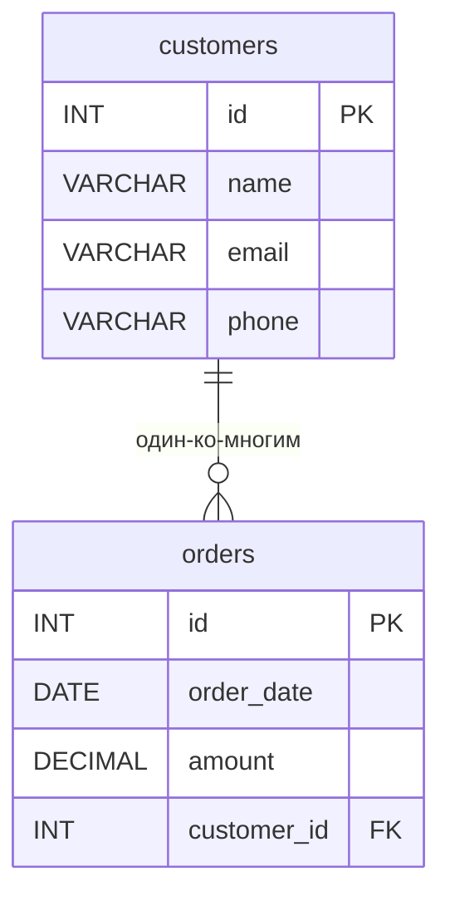

# ИТ.03 - 44 - Защита баз данных: шифрование данных и логирование изменений в MySQL

## Введение

В лекции 43 мы настроили **доступ** к базе данных: учётные записи `'user'@'host'`, привилегии и роли. Это защита «на входе»: пользователь не может выполнить то, на что у него нет прав. Но права работают только против того, кто **соблюдает правила**. Они не спасают в трёх типичных ситуациях:

- злоумышленник получил файлы базы данных (украден диск, снапшот виртуальной машины, резервная копия из лекции 35) и читает их напрямую, минуя MySQL;
- пароль приложения украден, и запросы идут **под легальной учётной записью** — привилегии у них есть, а данные уходят наружу;
- нужно доказать, **кто и когда** изменил запись: например, кто исправил сумму заказа или зарплату.

Поэтому защита базы данных строится из двух независимых слоёв:

1. **Шифрование** — делает данные бесполезными для того, кто получил к ним доступ в обход СУБД: на диске, в резервной копии, в канале связи.
2. **Логирование изменений (аудит)** — оставляет след: что изменилось, когда и под какой учётной записью. Без него невозможно ни расследование инцидента, ни выполнение требований регуляторов.

Эта лекция посвящена этим двум слоям в MySQL 8.0+ (примеры проверены на MySQL 8.4). Права и роли из лекции 43 считаются уже настроенными — мы их не отменяем, а **дополняем**.

**В этой лекции**:
- модель угроз: данные при передаче, при хранении и в журналах;
- шифрование канала: TLS, `REQUIRE SSL`, `require_secure_transport`;
- шифрование «в покое» средствами InnoDB (tablespace encryption) и его границы;
- шифрование на уровне приложения: `AES_ENCRYPT` / `AES_DECRYPT`, режимы, IV, миграция столбца;
- управление ключами: где хранить, как ротировать, почему ключ не должен попадать в SQL-текст;
- хеширование вместо шифрования: пароли, соль и «слепой индекс» для поиска;
- обзор журналов MySQL: error log, general query log, slow query log, binary log;
- аудит изменений через триггеры (лекция 33) и таблицу истории;
- защита журнала от подмены: права только на `INSERT`, хеш-цепочка, ротация и сроки хранения.

Примеры используют учебную базу интернет-магазина из лекции 43, расширенную персональными данными клиентов:

::: tabs

@tab Структура БД



@tab Дамп

```sql
-- Создание схемы и таблиц
CREATE DATABASE IF NOT EXISTS shop;
USE shop;

CREATE TABLE customers (
    id INT PRIMARY KEY AUTO_INCREMENT,
    name VARCHAR(100) NOT NULL,
    email VARCHAR(100) NOT NULL UNIQUE,
    phone VARCHAR(20)
);

CREATE TABLE orders (
    id INT PRIMARY KEY AUTO_INCREMENT,
    order_date DATE NOT NULL,
    amount DECIMAL(10,2) NOT NULL,
    customer_id INT,
    FOREIGN KEY (customer_id) REFERENCES shop.customers(id)
);

-- Вставка тестовых данных
INSERT INTO customers (name, email, phone) VALUES
('Иван Петров',    'ivan@example.com',   '+7 900 111-22-33'),
('Мария Сидорова', 'maria@example.com',  '+7 900 444-55-66'),
('Алексей Иванов', 'alexey@example.com', '+7 900 777-88-99');

INSERT INTO orders (order_date, amount, customer_id) VALUES
('2024-01-15', 5000.00,  1),
('2024-02-03', 12000.50, 2),
('2024-02-20', 3400.00,  1),
('2024-03-08', 8700.00,  3);
```

@tab Данные

::: tabs

@tab **customers**

| id | name            | email             | phone           |
|----|-----------------|-------------------|-----------------|
| 1  | Иван Петров     | ivan@example.com  | +7 900 111-22-33 |
| 2  | Мария Сидорова  | maria@example.com | +7 900 444-55-66 |
| 3  | Алексей Иванов  | alexey@example.com| +7 900 777-88-99 |

@tab **orders**

| id | order_date | amount   | customer_id |
|----|------------|----------|-------------|
| 1  | 2024-01-15 | 5000.00  | 1           |
| 2  | 2024-02-03 | 12000.50 | 2           |
| 3  | 2024-02-20 | 3400.00  | 1           |
| 4  | 2024-03-08 | 8700.00  | 3           |

:::

:::

::: note

Все команды, меняющие глобальные параметры сервера (`SET GLOBAL ...`, правка `my.cnf`), выполняются администратором. Шифрование столбцов и работа с журналом аудита доступны и обычному пользователю с соответствующими правами — это и есть смысл этих механизмов: они работают **внутри** обычных запросов.

:::

---

## Модель угроз: от чего именно защищаемся

Прежде чем включать шифрование, полезно ответить на вопрос: **от кого** мы защищаемся. Один и тот же механизм может быть бесполезен против одной угрозы и эффективен против другой.

| Угроза                                                        | Что помогает                                              |
|---------------------------------------------------------------|------------------------------------------------------------|
| Перехват трафика между приложением и сервером MySQL            | TLS (шифрование канала)                                    |
| Кража файлов данных, диска, снапшота ВМ                        | Шифрование «в покое» (TDE, шифрование на уровне ФС/диска)  |
| Кража резервной копии (`mysqldump`, лекция 35)                 | Шифрование дампа + шифрование столбцов с PII               |
| Утечка через логи и отчёты (телефон, паспорт в открытом виде)  | Шифрование/маскирование на уровне приложения               |
| Легальный пользователь БД читает чужие данные                  | Права и роли (лекция 43), представления, столбцовые права  |
| Подмена или удаление следов изменения данных                   | Аудит + append-only журнал + хеш-цепочка                   |
| DBA с `root` читает данные                                     | Только внешнее шифрование с ключом вне сервера БД          |

Последняя строка — ключевая. **Любое шифрование, ключ от которого лежит на том же сервере и доступен администратору БД, не защищает от администратора БД.** Оно защищает от кражи файлов и бэкапов, но не от `root`. Это не повод отказываться от TDE — просто нужно честно понимать границу.

## Шифрование данных при передаче

Приложение подключается к MySQL по сети, и без TLS логин, пароль и все данные идут открытым текстом. Проверить, поддерживает ли сервер TLS:

```sql
SHOW VARIABLES LIKE 'have_ssl';
```

```text
+---------------+-------+
| Variable_name | Value |
+---------------+-------+
| have_ssl      | YES   |
+---------------+-------+
```

Если TLS включён, посмотрим, что реально используется в текущем соединении:

```sql
SHOW STATUS LIKE 'Ssl_version';
SHOW STATUS LIKE 'Ssl_cipher';
```

```text
+---------------+--------------------+
| Variable_name | Value              |
+---------------+--------------------+
| Ssl_version   | TLSv1.3            |
| Ssl_cipher    | TLS_AES_256_GCM_SHA384 |
+---------------+--------------------+
```

Пустой `Ssl_cipher` означает, что соединение **не зашифровано**. Чтобы зашифровать канал обязательно, включают на сервере:

```ini
[mysqld]
require_secure_transport = ON
```

После этого незашифрованные подключения отклоняются с ошибкой `ERROR 3159 (HY000): Connections using insecure transport are prohibited`. Дополнительно можно потребовать TLS **для конкретной учётной записи** — это удобно для приложения и не мешает локальным административным подключениям:

```sql
ALTER USER 'app_user'@'10.0.0.5' REQUIRE SSL;
```

Клиент тоже должен явно требовать шифрование:

```bash
mysql --ssl-mode=REQUIRED -h 10.0.0.10 -u app_user -p
```

::: warning

`REQUIRE SSL` требует именно зашифрованный канал, но не проверяет подлинность сервера. Для проверки сертификата сервера используется `REQUIRE X509` (или `--ssl-mode=VERIFY_IDENTITY` на клиенте). Без проверки сертификата возможна атака «человек посередине» с подменой сервера.

:::

## Шифрование данных при хранении: InnoDB tablespace encryption

MySQL (точнее, InnoDB) умеет шифровать файлы табличных пространств на диске. Данные расшифровываются «на лету» при чтении и шифруются при записи, поэтому для SQL-запросов ничего не меняется.

Для работы нужен **keyring** — хранилище мастер-ключа. В MySQL 8.4 это компонент, подключаемый в `mysqld.my`:

```json
{
  "components": "file://component_keyring_file"
}
```

и его конфигурация:

```json
{
  "path": "/var/lib/mysql-keyring/keyring"
}
```

После запуска сервера с keyring шифрование включается на уровне таблицы:

```sql
CREATE TABLE shop.payments (
    id INT PRIMARY KEY AUTO_INCREMENT,
    order_id INT NOT NULL,
    card_last4 CHAR(4) NOT NULL,
    amount DECIMAL(10,2) NOT NULL
) ENCRYPTION = 'Y';
```

Проверить, что таблица действительно зашифрована:

```sql
SELECT NAME, ENCRYPTION
FROM information_schema.INNODB_TABLESPACES
WHERE NAME LIKE 'shop/%';
```

```text
+-------------+------------+
| NAME        | ENCRYPTION |
+-------------+------------+
| shop/orders | N          |
| shop/payments | Y        |
+-------------+------------+
```

Уже существующую таблицу можно зашифровать на месте:

```sql
ALTER TABLE shop.payments ENCRYPTION = 'Y';
```

А чтобы не забывать про новые таблицы, включают шифрование по умолчанию:

```ini
[mysqld]
default_table_encryption = ON
```

::: warning

TDE в InnoDB защищает **файлы на диске**: если злоумышленник получит доступ к `ibd`-файлам или к резервной копии каталога данных, он не прочитает содержимое. Но он ничего не даёт против SQL-запроса: любой пользователь с правом `SELECT` (лекция 43) видит данные в открытом виде. TDE также **не шифрует** дампы, созданные `mysqldump` — они выгружаются как обычный текст. Про дампы — лекция 35.

:::

## Шифрование на уровне приложения

Когда нужно, чтобы данные были недоступны даже администратору БД, шифрование переносят в приложение: сервер хранит только зашифрованные байты, а ключ находится вне базы. MySQL даёт для этого пару функций `AES_ENCRYPT` / `AES_DECRYPT` — удобных для демонстрации и для отчётов, хотя в промышленной системе шифрование чаще делают в коде приложения с аутентифицированным шифрованием (AES-GCM, libsodium).

### AES_ENCRYPT и AES_DECRYPT

```sql
SET block_encryption_mode = 'aes-256-cbc';
SET @key = UNHEX(SHA2('demo-master-key', 256));

SELECT HEX(AES_ENCRYPT('+7 900 111-22-33', @key)) AS ciphertext;
```

```text
+----------------------------------+
| ciphertext                       |
+----------------------------------+
| 6B1F0C7A9D2E45B8A3C4F5D6E7A8B9C0 |
+----------------------------------+
```

`AES_ENCRYPT` возвращает **двоичную строку**, поэтому хранить результат нужно в `VARBINARY` (или в `BLOB`), а не в `VARCHAR` — иначе MySQL попытается интерпретировать байты как текст и данные будут испорчены. Расшифровка:

```sql
SELECT CONVERT(AES_DECRYPT(ciphertext, @key) USING utf8mb4)
FROM (SELECT AES_ENCRYPT('+7 900 111-22-33', @key) AS ciphertext) AS t;
```

```text
+------------------------------------------------------+
| CONVERT(AES_DECRYPT(ciphertext, @key) USING utf8mb4) |
+------------------------------------------------------+
| +7 900 111-22-33                                     |
+------------------------------------------------------+
```

Три правила, без которых `AES_ENCRYPT` бесполезен:

1. **Режим должен совпадать** при шифровании и расшифровке. По умолчанию используется `aes-128-ecb` — режим без IV, который «просвечивает» одинаковые блоки. Всегда явно задавайте `aes-256-cbc` (или `aes-256-cfb1`/`aes-256-ofb`) и делайте это в каждой сессии.
2. **IV должен быть случайным для каждой строки.** В режиме CBC одинаковый текст с одинаковым IV даёт одинаковый шифротекст — по базе сразу видно, у кого одинаковые номера телефонов. IV не секретен, но его нужно хранить рядом с шифротекстом.
3. **Ключ — это не пароль.** MySQL не выполняет криптостойкое наследование ключа из пароля: строка ключа просто приводится к нужной длине. Ключ должен быть случайными байтами (`RANDOM_BYTES(32)`), полученными из keyring или KMS, а не осмысленной фразой.

::: note

Аргумент IV у `AES_ENCRYPT`/`AES_DECRYPT` появился в MySQL 8.0.30. В более старых версиях IV задать нельзя, и CBC-режимы использовать небезопасно — там остаётся только шифрование в приложении.

:::

### Миграция существующего столбца

Перенесём открытый `phone` в зашифрованный вид. Нужны два новых столбца: сам шифротекст и IV.

```sql
SET block_encryption_mode = 'aes-256-cbc';
SET @key = UNHEX(SHA2('demo-master-key', 256));

ALTER TABLE shop.customers
    ADD COLUMN phone_iv  VARBINARY(16),
    ADD COLUMN phone_enc VARBINARY(255);

-- 1. Свой случайный IV для каждой строки
UPDATE shop.customers SET phone_iv = RANDOM_BYTES(16);

-- 2. Шифруем открытое значение
UPDATE shop.customers
SET phone_enc = AES_ENCRYPT(phone, @key, phone_iv);

-- 3. Убеждаемся, что всё расшифровывается
SELECT id,
       CONVERT(AES_DECRYPT(phone_enc, @key, phone_iv) USING utf8mb4) AS phone
FROM shop.customers;
```

| id | phone            |
|----|------------------|
| 1  | +7 900 111-22-33 |
| 2  | +7 900 444-55-66 |
| 3  | +7 900 777-88-99 |

Только после проверки открытый столбец удаляется:

```sql
ALTER TABLE shop.customers DROP COLUMN phone;
```

Теперь то, что видит пользователь без ключа:

```sql
SELECT id, name, HEX(phone_enc) AS phone_enc_hex, HEX(phone_iv) AS phone_iv_hex
FROM shop.customers;
```

| id | name           | phone_enc_hex                    | phone_iv_hex                     |
|----|----------------|----------------------------------|----------------------------------|
| 1  | Иван Петров    | 6B1F0C7A9D2E45B8A3C4F5D6E7A8B9C0 | 0A1B2C3D4E5F60718293A4B5C6D7E8F9 |
| 2  | Мария Сидорова | 9C8D7E6F5A4B3C2D1E0F9A8B7C6D5E4F | 11223344556677889900AABBCCDDEEFF |
| 3  | Алексей Иванов | 3E2D1C0B4A5968778695A4B3C2D1E0F9 | FFEEDDCCBBAA99887766554433221100 |

С неправильным ключом `AES_DECRYPT` вернёт `NULL`, а не ошибку — это важная деталь: проверять корректность расшифровки нужно явно, иначе приложение молча получит «пустые» данные.

```sql
SET @wrong_key = UNHEX(SHA2('another-key', 256));

SELECT id, AES_DECRYPT(phone_enc, @wrong_key, phone_iv) AS phone
FROM shop.customers
WHERE id = 1;
```

```text
+----+-------+
| id | phone |
+----+-------+
|  1 | NULL  |
+----+-------+
```

### Управление ключами

Ключ — самая уязвимая часть схемы. Типичные ошибки и как их избежать:

- **ключ в SQL-тексте.** `AES_ENCRYPT(phone, 'secret', iv)` попадает в general query log, в `performance_schema`, в binlog и в историю клиента. Ключ нужно передавать параметром запроса из приложения или читать из keyring/KMS;
- **ключ в той же базе.** Таблица `settings` с ключом рядом с шифротекстом не защищает ни от чего: тот, кто украл базу, украл и ключ;
- **один ключ на всё и навсегда.** Ротация ключей — обязательная процедура: старые данные перешифровываются новым ключом, старый ключ выводится из обращения. Поэтому в таблице полезно хранить версию ключа (`key_version SMALLINT`);
- **ключ в репозитории.** Ключи не коммитят в Git — только в секрет-хранилище (Vault, KMS, keyring);
- **разделение обязанностей.** Тот, кто может сделать `SELECT`, не должен иметь доступа к ключу; тот, у кого есть ключ, не должен иметь доступа к серверу БД.

### Поиск по зашифрованным данным

Главное ограничение шифрования: по шифротексту **нельзя искать и нельзя строить обычный индекс**. `WHERE phone_enc = AES_ENCRYPT('+7 900 111-22-33', @key, ...)` не сработает: IV каждый раз новый, шифротекст разный. Есть три подхода:

| Подход                              | Что даёт                                   | Цена                                  |
|-------------------------------------|--------------------------------------------|---------------------------------------|
| Детерминированное шифрование        | Поиск по точному совпадению                | Утечка равенства: видно одинаковые значения |
| «Слепой индекс» (blind index)       | Поиск по точному совпадению, без утечки самого значения | Нужен отдельный ключ, индекс хранит хеш |
| Поиск в приложении                 | Полная безопасность                        | Читать приходится больше строк         |

«Слепой индекс» — это отдельный столбец с хешем от значения и ключа, по которому строится обычный индекс:

```sql
ALTER TABLE shop.customers ADD COLUMN phone_bidx CHAR(64);

UPDATE shop.customers
SET phone_bidx = SHA2(CONCAT('bidx-key', phone), 256);

CREATE INDEX idx_customers_phone_bidx ON shop.customers (phone_bidx);
```

Теперь поиск клиента по номеру выглядит так:

```sql
SELECT id, name
FROM shop.customers
WHERE phone_bidx = SHA2(CONCAT('bidx-key', '+7 900 444-55-66'), 256);
```

```text
+----+----------------+
| id | name           |
+----+----------------+
|  2 | Мария Сидорова |
+----+----------------+
```

::: note

Строго говоря, для «слепого индекса» нужен HMAC с отдельным ключом, а не `SHA2` от конкатенации: у `SHA2` есть свойство length-extension, а подмешивание ключа через `CONCAT` — компромисс, доступный встроенными средствами MySQL. Ключ `bidx-key` должен отличаться от ключа шифрования и храниться там же, где ключ шифрования — вне базы.

:::

## Хеширование вместо шифрования

Пароли, коды подтверждения и токены **не шифруют** — их хешируют. Разница принципиальна: шифрование обратимо (у нас есть ключ), хеширование — нет, и это именно то, что нужно: сервер не должен уметь восстановить пароль пользователя.

```sql
-- Плохо: обратимое «шифрование» пароля
SELECT HEX(AES_ENCRYPT('Pa55w0rd', @key));

-- Приемлемо в учебной БД: соль + SHA2
SELECT SHA2(CONCAT('user-salt-42', 'Pa55w0rd'), 256);
```

| Что хранить          | Чем проверять                     |
|----------------------|-----------------------------------|
| Пароль пользователя  | `argon2id` или `bcrypt` в приложении |
| Простой хеш          | `SHA2(...)` с индивидуальной солью |
| Код подтверждения    | Хеш + короткий срок жизни + лимит попыток |
| Номер карты          | Токенизация у платёжного провайдера |

В MySQL нет встроенных `bcrypt`/`argon2` — их считает приложение, а в базе хранится готовая строка вида `$argon2id$v=19$...`. Хеширование через `SHA2` быстрее поддаётся перебору, поэтому допустимо только там, где пароль и так не критичен (например, учебный стенд).

Отдельно напомним: способ аутентификации самих учётных записей MySQL (`caching_sha2_password`) — это другая тема, она разобрана в лекции 43.

## Логирование изменений: обзор механизмов

В MySQL есть несколько журналов, и важно понимать, что **ни один из них не является аудитом «из коробки»** в Community-редакции.

| Журнал                        | Что пишет                                      | Подходит для аудита? |
|-------------------------------|------------------------------------------------|----------------------|
| Error log                     | запуск, ошибки, падения, предупреждения         | нет                  |
| General query log             | **все** полученные запросы                      | частично, но опасен  |
| Slow query log                | запросы дольше `long_query_time`                | нет                  |
| Binary log (`binlog`)         | изменения данных (и структуры)                  | для восстановления, не для «кто» |
| Enterprise Audit (`audit_log`)| события доступа и запросы, с учётной записью    | да, но только Enterprise |
| Таблица истории + триггеры    | изменения конкретных таблиц, с `USER()`         | да, своими руками     |

### General query log: полезно и опасно одновременно

```sql
SET GLOBAL general_log = ON;
SHOW VARIABLES LIKE 'general_log_file';
```

В журнал попадёт буквально всё, включая:

```text
2024-03-08T10:15:22.123456Z  42 Query  INSERT INTO customers (phone) VALUES ('+7 900 111-22-33')
2024-03-08T10:15:31.654321Z  42 Query  CREATE USER 'x'@'%' IDENTIFIED BY 'Pl4inText!'
```

Это делает general log **источником утечки**: он содержит персональные данные и пароли в открытом виде, а шифрование столбца тут не помогает — в журнал попадает исходный текст запроса, а не шифротекст. Включать его следует только на время диагностики, на минимальный срок, и сразу выключать:

```sql
SET GLOBAL general_log = OFF;
```

Файл журнала должен быть доступен только пользователю `mysql` (`chmod 640`), а не всем.

### Slow query log

Полезен для производительности и для поиска подозрительной активности (например, массовой выгрузки):

```sql
SET GLOBAL slow_query_log = ON;
SET GLOBAL long_query_time = 1;
```

Slow log не содержит всех изменений, поэтому как аудит не годится, но как дополнительный источник при расследовании — вполне.

## Бинарный журнал (binlog)

Бинарный журнал — это последовательность событий об изменениях данных. Он нужен для репликации и для восстановления на момент времени (point-in-time recovery, лекция 35), но его же удобно использовать как «сырую» историю изменений.

```sql
SHOW VARIABLES LIKE 'log_bin';
SHOW VARIABLES LIKE 'binlog_format';
SHOW VARIABLES LIKE 'binlog_row_image';
```

```text
+-------------------+-------+
| Variable_name     | Value |
+-------------------+-------+
| log_bin           | ON    |
| binlog_format     | ROW   |
| binlog_row_image  | FULL  |
+-------------------+-------+
```

- `binlog_format = ROW` — в журнал попадают строки «до» и «после», а не текст запроса. Это точнее и безопаснее: в журнале нет открытых значений из `WHERE`, если они не менялись;
- `binlog_row_image = FULL` — сохраняются все столбцы строки, а не только изменённые. Без этого нельзя восстановить прежнее значение;
- `binlog_rows_query_log_events = ON` — дополнительно записывает исходный текст запроса, что помогает разбирать инциденты (но снова возвращает риск PII в журнале).

Просмотр событий:

```sql
SHOW BINARY LOGS;
SHOW BINLOG EVENTS IN 'binlog.000001' LIMIT 10;
```

Разбор файла утилитой (в том числе с удалённого сервера):

```bash
mysqlbinlog --read-from-remote-server --host=10.0.0.10 \
    --user=repl_reader --password \
    --base64-output=DECODE-ROWS -v binlog.000001
```

Для сохранности журнала при сбое важны настройки:

```ini
[mysqld]
sync_binlog = 1
innodb_flush_log_at_trx_commit = 1
binlog_expire_logs_seconds = 2592000
```

`sync_binlog = 1` заставляет сервер сбрасывать журнал на диск при каждой транзакции, а `binlog_expire_logs_seconds` (по умолчанию 30 дней) задаёт срок хранения. Удалять журналы вручную нужно аккуратно:

```sql
PURGE BINARY LOGS TO 'binlog.000042';
```

::: warning

В binlog **нет учётной записи**, под которой выполнено изменение: событие содержит `thread_id`, но не имя пользователя. То есть binlog отвечает на вопрос «что изменилось», но не на вопрос «кто изменил». Для второго нужен либо Enterprise Audit, либо собственный журнал на триггерах.

:::

## Аудит изменений через триггеры

В Community-редакции самый доступный способ узнать «кто, что и когда» — писать историю изменений в отдельную таблицу из триггеров (лекция 33). Схема простая: при каждом `INSERT`, `UPDATE` и `DELETE` триггер добавляет запись в журнал.

### Таблица аудита

Журнал выносим в отдельную схему `audit` — так проще раздавать права: приложению не нужен доступ к `shop.*`, чтобы писать аудит.

```sql
CREATE DATABASE IF NOT EXISTS audit;

CREATE TABLE audit.orders_audit (
    id          BIGINT PRIMARY KEY AUTO_INCREMENT,
    operation   ENUM('INSERT','UPDATE','DELETE') NOT NULL,
    order_id    INT NOT NULL,
    old_row     JSON,
    new_row     JSON,
    changed_by  VARCHAR(100) NOT NULL,
    changed_at  DATETIME(6) NOT NULL DEFAULT CURRENT_TIMESTAMP(6),
    payload     TEXT NOT NULL,
    row_hash    CHAR(64) NOT NULL
) ENGINE = InnoDB;
```

- `old_row` и `new_row` — снимки строки в формате JSON: так журнал переживёт изменение структуры таблицы;
- `changed_by` — учётная запись, от имени которой пришло изменение;
- `payload` и `row_hash` — для защиты от подмены, о них ниже.

### Триггер на UPDATE

```sql
DELIMITER $$

CREATE TRIGGER shop.orders_after_update
AFTER UPDATE ON shop.orders
FOR EACH ROW
BEGIN
    DECLARE prev_hash CHAR(64);
    DECLARE payload   TEXT;

    -- Хеш предыдущей записи журнала (начало цепочки — 64 нуля)
    SET prev_hash = COALESCE(
        (SELECT row_hash FROM audit.orders_audit ORDER BY id DESC LIMIT 1),
        REPEAT('0', 64)
    );

    SET payload = CONCAT_WS('|',
        prev_hash,
        'UPDATE',
        OLD.id,
        IFNULL(CAST(OLD.order_date AS CHAR), '~'),
        OLD.amount,
        IFNULL(OLD.customer_id, '~'),
        IFNULL(CAST(NEW.order_date AS CHAR), '~'),
        NEW.amount,
        IFNULL(NEW.customer_id, '~'),
        USER(),
        CAST(NOW(6) AS CHAR)
    );

    INSERT INTO audit.orders_audit
        (operation, order_id, old_row, new_row, changed_by, payload, row_hash)
    VALUES
        ('UPDATE', OLD.id,
         JSON_OBJECT('order_date', OLD.order_date,
                     'amount', OLD.amount,
                     'customer_id', OLD.customer_id),
         JSON_OBJECT('order_date', NEW.order_date,
                     'amount', NEW.amount,
                     'customer_id', NEW.customer_id),
         USER(), payload, SHA2(payload, 256));
END$$

DELIMITER ;
```

Проверим:

```sql
UPDATE shop.orders SET amount = 6200.00 WHERE id = 1;
```

```sql
SELECT operation, order_id, old_row, new_row, changed_by, changed_at
FROM audit.orders_audit;
```

| operation | order_id | old_row                                              | new_row                                              | changed_by        | changed_at             |
|-----------|----------|------------------------------------------------------|------------------------------------------------------|-------------------|------------------------|
| UPDATE    | 1        | `{"amount": 5000.00, "customer_id": 1, ...}`          | `{"amount": 6200.00, "customer_id": 1, ...}`          | app_user@localhost | 2024-03-08 10:20:41.000000 |

::: warning

В теле триггера `CURRENT_USER()` возвращает **владельца триггера** (DEFINER), а не того, кто выполнил запрос: триггеры всегда выполняются с привилегиями определителя. Поэтому для поля «кто» используется `USER()` — аккаунт, под которым реально подключён клиент. Если за приложением стоят конкретные сотрудники, приложение дополнительно выставляет `@app_user` на время запроса, а триггер пишет `COALESCE(@app_user, USER())`. Имейте в виду: при пуле соединений `USER()` — это учётная запись приложения, а не конечный пользователь.

:::

### Триггеры на INSERT и DELETE

Отличие только в доступности `OLD` и `NEW`:

| Событие  | `OLD` | `NEW` |
|----------|-------|-------|
| `INSERT` | нет   | есть  |
| `UPDATE` | есть  | есть  |
| `DELETE` | есть  | нет   |

```sql
DELIMITER $$

CREATE TRIGGER shop.orders_after_delete
AFTER DELETE ON shop.orders
FOR EACH ROW
BEGIN
    DECLARE prev_hash CHAR(64);
    DECLARE payload   TEXT;

    SET prev_hash = COALESCE(
        (SELECT row_hash FROM audit.orders_audit ORDER BY id DESC LIMIT 1),
        REPEAT('0', 64)
    );

    SET payload = CONCAT_WS('|',
        prev_hash, 'DELETE', OLD.id,
        IFNULL(CAST(OLD.order_date AS CHAR), '~'),
        OLD.amount,
        IFNULL(OLD.customer_id, '~'),
        USER(),
        CAST(NOW(6) AS CHAR)
    );

    INSERT INTO audit.orders_audit
        (operation, order_id, old_row, changed_by, payload, row_hash)
    VALUES
        ('DELETE', OLD.id,
         JSON_OBJECT('order_date', OLD.order_date,
                     'amount', OLD.amount,
                     'customer_id', OLD.customer_id),
         USER(), payload, SHA2(payload, 256));
END$$

DELIMITER ;
```

### Защита журнала от изменений

Журнал аудита бесполезен, если его можно тихо исправить. Базовые меры:

1. **Права только на `INSERT` и `SELECT`.** Приложение пишет журнал через триггер (он выполняется с правами DEFINER и прав приложения не требует), а само править записи не может:

```sql
GRANT INSERT, SELECT ON audit.orders_audit TO 'app_user'@'10.0.0.5';
-- UPDATE и DELETE не выдаём
```

Проверка под `app_user`:

```sql
UPDATE audit.orders_audit SET new_row = '{}' WHERE id = 1;
```

```text
ERROR 1142 (42000): UPDATE command denied to user 'app_user'@'10.0.0.5'
for table 'orders_audit'
```

2. **Отдельная схема и отдельный диск.** Журнал растёт быстро и не должен конкурировать за место с боевыми таблицами.

3. **Хеш-цепочка.** Каждая запись содержит хеш от своего содержимого и хеша предыдущей записи. Изменить одну строку незаметно уже нельзя: сломается либо её собственный хеш, либо связь со следующей.

Проверка целостности — оконная функция `LAG` (лекции 39–40):

```sql
SELECT id,
       operation,
       row_hash = SHA2(payload, 256) AS hash_ok,
       SUBSTRING_INDEX(payload, '|', 1) = COALESCE(
           LAG(row_hash) OVER (ORDER BY id),
           REPEAT('0', 64)
       ) AS link_ok
FROM audit.orders_audit
ORDER BY id;
```

```text
+----+-----------+---------+---------+
| id | operation | hash_ok | link_ok |
+----+-----------+---------+---------+
|  1 | UPDATE    |       1 |       1 |
|  2 | DELETE    |       1 |       1 |
+----+-----------+---------+---------+
```

Если администратор с `root` исправит `old_row` в первой записи, `hash_ok` станет `0`. Если он пересчитает и `row_hash`, — сломается `link_ok` у следующей записи. Полностью обойти это можно, только пересчитав всю цепочку, поэтому:

::: warning

Хеш-цепочка защищает от **точечной** правки, но не от того, кто имеет полный доступ к серверу и может перезаписать весь журнал. Для настоящей неотказуемости нужен внешний якорь: периодическая отправка последнего хеша в отдельную систему (SIEM, WORM-хранилище, неизменяемое объектное хранилище) или подпись записей ключом, которого нет на сервере БД.

:::

4. **Сроки хранения.** Журнал содержит персональные данные, поэтому у него должен быть срок хранения и процедура архивирования. Простое `DELETE` по дате ломает цепочку — архив нужно закрывать «якорем»: сохранять последний хеш выгружаемого диапазона и хранить его вместе с архивом.

```sql
-- Кандидаты на архивирование
SELECT COUNT(*) FROM audit.orders_audit
WHERE changed_at < NOW() - INTERVAL 1 YEAR;
```

### Цена аудита

Триггер на каждое изменение — это дополнительная запись в транзакции, то есть:

- растёт время `INSERT`/`UPDATE`/`DELETE`;
- увеличивается объём журнала транзакций и binlog;
- при массовой загрузке (например, `LOAD DATA`) журнал может вырасти в разы;
- цепочка хешей сериализует записи: при высокой конкуренции транзакции будут ждать друг друга.

Поэтому аудит включают **выборочно**: на таблицы с деньгами, правами доступа и персональными данными, а не на всю базу. Для больших объёмов журнал партиционируют по месяцам и выносят на отдельный диск.

## Практический сценарий: шифрование + аудит + права

Соберём всё вместе для базы `shop`. Задача: приложение работает по TLS, телефоны клиентов хранятся зашифрованными, изменения заказов попадают в защищённый журнал, а приложение не может ни прочитать лишнего, ни исправить историю.

```sql
-- 1. Канал: только TLS для учётной записи приложения
ALTER USER 'app_user'@'10.0.0.5' REQUIRE SSL;

-- 2. Данные: приложение читает и пишет только данные, без структуры
GRANT SELECT, INSERT, UPDATE, DELETE ON shop.* TO 'app_user'@'10.0.0.5';

-- 3. Журнал: только добавление и чтение, без правки
GRANT INSERT, SELECT ON audit.orders_audit TO 'app_user'@'10.0.0.5';

-- 4. Аналитик: только чтение, без доступа к зашифрованным столбцам
GRANT SELECT (id, name, email) ON shop.customers TO 'analyst'@'localhost';
REVOKE SELECT ON shop.customers FROM 'analyst'@'localhost';

-- 5. Проверка
SHOW GRANTS FOR 'app_user'@'10.0.0.5';
```

Итоговые свойства схемы:

- **канал** зашифрован, украденный трафик не даёт ни пароля, ни данных;
- **телефоны** в базе и в резервных копиях лежат шифротекстом, ключ — вне сервера;
- **журнал** нельзя исправить под учётной записью приложения, а точечная правка ломает хеш-цепочку;
- **аналитик** видит только неконфиденциальные столбцы (столбцовые привилегии из лекции 43);
- **DBA** по-прежнему может читать данные через `SELECT` — это осознанно принятый остаточный риск, закрываемый только внешним шифрованием с ключом вне БД.

## Задания

### Задание 1

::: tabs

@tab Условие

Зашифруйте столбец `email` таблицы `shop.customers` режимом `aes-256-cbc` с отдельным случайным IV для каждой строки. Убедитесь, что: данные расшифровываются правильным ключом, не расшифровываются неправильным, а в базе нет открытых адресов. Объясните, почему для `email` нельзя просто добавить `UNIQUE` после шифрования.

@tab Решение

```sql
SET block_encryption_mode = 'aes-256-cbc';
SET @key = UNHEX(SHA2('demo-master-key', 256));

ALTER TABLE shop.customers
    ADD COLUMN email_iv  VARBINARY(16),
    ADD COLUMN email_enc VARBINARY(255);

UPDATE shop.customers SET email_iv = RANDOM_BYTES(16);

UPDATE shop.customers
SET email_enc = AES_ENCRYPT(email, @key, email_iv);
```

Проверка расшифровки:

```sql
SELECT id,
       CONVERT(AES_DECRYPT(email_enc, @key, email_iv) USING utf8mb4) AS email
FROM shop.customers;
```

| id | email             |
|----|-------------------|
| 1  | ivan@example.com  |
| 2  | maria@example.com |
| 3  | alexey@example.com|

Проверка «чужим» ключом:

```sql
SET @wrong_key = UNHEX(SHA2('wrong-key', 256));

SELECT id, AES_DECRYPT(email_enc, @wrong_key, email_iv) AS email
FROM shop.customers WHERE id = 1;
```

```text
+----+-------+
| id | email |
+----+-------+
|  1 | NULL  |
+----+-------+
```

`UNIQUE` на `email_enc` бесполезен: IV у каждой строки свой, поэтому одинаковые адреса дают разные шифротексты и ограничение ничего не проверяет. Для контроля уникальности нужен отдельный «слепой индекс» (`email_bidx`) с хешем от значения и ключа — тогда `UNIQUE` ставится на него.

:::

### Задание 2

::: tabs

@tab Условие

Создайте журнал аудита для таблицы `shop.orders`, который фиксирует `INSERT`, `UPDATE` и `DELETE` с полями «до» и «после», учётной записью и временем. Проверьте, что после вставки заказа в журнале появляется запись, а пользователь `app_user` не может изменить журнал.

@tab Решение

Таблица журнала — как в лекции:

```sql
CREATE TABLE IF NOT EXISTS audit.orders_audit (
    id          BIGINT PRIMARY KEY AUTO_INCREMENT,
    operation   ENUM('INSERT','UPDATE','DELETE') NOT NULL,
    order_id    INT NOT NULL,
    old_row     JSON,
    new_row     JSON,
    changed_by  VARCHAR(100) NOT NULL,
    changed_at  DATETIME(6) NOT NULL DEFAULT CURRENT_TIMESTAMP(6),
    payload     TEXT NOT NULL,
    row_hash    CHAR(64) NOT NULL
) ENGINE = InnoDB;
```

Триггер на вставку:

```sql
DELIMITER $$

CREATE TRIGGER shop.orders_after_insert
AFTER INSERT ON shop.orders
FOR EACH ROW
BEGIN
    DECLARE prev_hash CHAR(64);
    DECLARE payload   TEXT;

    SET prev_hash = COALESCE(
        (SELECT row_hash FROM audit.orders_audit ORDER BY id DESC LIMIT 1),
        REPEAT('0', 64)
    );

    SET payload = CONCAT_WS('|',
        prev_hash, 'INSERT', NEW.id,
        IFNULL(CAST(NEW.order_date AS CHAR), '~'),
        NEW.amount,
        IFNULL(NEW.customer_id, '~'),
        USER(),
        CAST(NOW(6) AS CHAR)
    );

    INSERT INTO audit.orders_audit
        (operation, order_id, new_row, changed_by, payload, row_hash)
    VALUES
        ('INSERT', NEW.id,
         JSON_OBJECT('order_date', NEW.order_date,
                     'amount', NEW.amount,
                     'customer_id', NEW.customer_id),
         USER(), payload, SHA2(payload, 256));
END$$

DELIMITER ;
```

Проверка:

```sql
INSERT INTO shop.orders (order_date, amount, customer_id)
VALUES ('2024-03-10', 2100.00, 2);

SELECT operation, order_id, new_row, changed_by
FROM audit.orders_audit;
```

| operation | order_id | new_row                                             | changed_by        |
|-----------|----------|-----------------------------------------------------|-------------------|
| INSERT    | 5        | `{"amount": 2100.00, "customer_id": 2, ...}`         | app_user@localhost |

Попытка подправить журнал под `app_user`:

```sql
UPDATE audit.orders_audit SET new_row = '{}' WHERE order_id = 5;
```

```text
ERROR 1142 (42000): UPDATE command denied to user 'app_user'@'10.0.0.5'
for table 'orders_audit'
```

Права выданы только на `INSERT` и `SELECT`, поэтому история доступна для чтения, но не для правки.

:::

### Задание 3

::: tabs

@tab Условие

В журнале `audit.orders_audit` злоумышленник с правами `root` исправил сумму в `old_row` одной из записей, чтобы скрыть изменение заказа. Найдите первую запись с нарушенной целостностью, используя оконную функцию `LAG`, и объясните, что произойдёт, если злоумышленник дополнительно пересчитает `row_hash` этой записи.

@tab Решение

```sql
SELECT id,
       operation,
       row_hash = SHA2(payload, 256) AS hash_ok,
       SUBSTRING_INDEX(payload, '|', 1) = COALESCE(
           LAG(row_hash) OVER (ORDER BY id),
           REPEAT('0', 64)
       ) AS link_ok
FROM audit.orders_audit
ORDER BY id;
```

```text
+----+-----------+---------+---------+
| id | operation | hash_ok | link_ok |
+----+-----------+---------+---------+
|  1 | UPDATE    |       1 |       1 |
|  2 | DELETE    |       0 |       1 |
|  3 | INSERT    |       1 |       0 |
+----+-----------+---------+---------+
```

- запись `id = 2` изменена: её содержимое больше не соответствует `row_hash` (`hash_ok = 0`);
- если злоумышленник пересчитает `row_hash` для `id = 2`, `hash_ok` снова станет `1`, но `link_ok` у записи `id = 3` превратится в `0`, потому что её `payload` ссылается на **старый** хеш;
- чтобы скрыть след полностью, придётся пересчитать всю цепочку до последней записи, а последний хеш уже может быть отправлен во внешний якорь (SIEM/WORM), где подменить его нельзя.

Поэтому хеш-цепочка обнаруживает точечную правку, но не заменяет внешний неизменяемый якорь.

:::

---

## Заключение

В этой лекции мы разобрали два слоя защиты, которые дополняют права и роли из лекции 43.

**Шифрование** отвечает на вопрос «кто может прочитать данные». Канал защищается TLS (`require_secure_transport`, `REQUIRE SSL`), файлы на диске — tablespace encryption в InnoDB (`ENCRYPTION='Y'` и keyring), а данные, недоступные даже администратору БД, — шифрованием на уровне приложения: `AES_ENCRYPT`/`AES_DECRYPT` в режиме `aes-256-cbc`, случайный IV на каждую строку, ключ вне базы, отдельный «слепой индекс» для поиска. Пароли при этом не шифруются, а хешируются.

**Логирование изменений** отвечает на вопрос «кто и когда это сделал». Error log и slow log дают диагностику, general query log — полную картину запросов (и одновременно риск утечки PII), binlog — точную историю изменений для восстановления, но без учётной записи. Настоящий аудит в Community-редакции собирается из таблицы истории и триггеров: `JSON`-снимки «до» и «после», `USER()`, время и хеш-цепочка, которая делает точечную подмену заметной. Приложение получает на журнал только `INSERT` и `SELECT` — и физически не может исправить историю.

Главный вывод: шифрование без управления ключами бессмысленно, а аудит без защиты журнала бесполезен. Оба механизма имеют границы — TDE не спасает от `SELECT`, а хеш-цепочка не спасает от полного доступа к серверу, — поэтому защита строится слоями, а остаточные риски фиксируются осознанно.

## Полезные ссылки

- [MySQL 8.4 Reference Manual: Security](https://dev.mysql.com/doc/refman/8.4/en/security.html)
- [MySQL 8.4 Reference Manual: Encrypted Connection TLS Protocols and Ciphers](https://dev.mysql.com/doc/refman/8.4/en/encrypted-connection-protocols-ciphers.html)
- [MySQL 8.4 Reference Manual: InnoDB Data-at-Rest Encryption](https://dev.mysql.com/doc/refman/8.4/en/innodb-data-encryption.html)
- [MySQL 8.4 Reference Manual: Encryption and Compression Functions](https://dev.mysql.com/doc/refman/8.4/en/encryption-functions.html)
- [MySQL 8.4 Reference Manual: Keyring Components](https://dev.mysql.com/doc/refman/8.4/en/keyring.html)
- [MySQL 8.4 Reference Manual: The Binary Log](https://dev.mysql.com/doc/refman/8.4/en/binary-log.html)
- [MySQL 8.4 Reference Manual: MySQL Enterprise Audit](https://dev.mysql.com/doc/refman/8.4/en/audit-log.html)
- [MySQL 8.4 Reference Manual: Server Logs](https://dev.mysql.com/doc/refman/8.4/en/server-logs.html)
